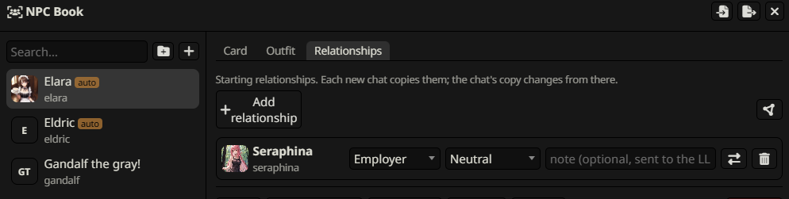
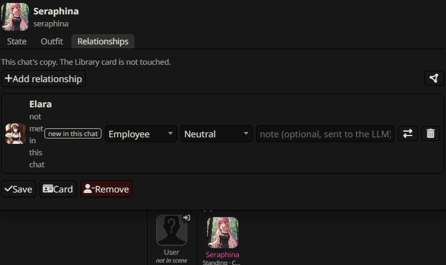
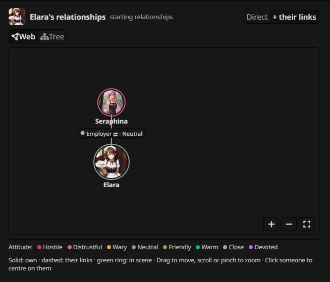

# NPC Book — Relationships

A sister extension for [NPC Book](https://github.com/lalzy/ST-NPC-Book) 

This extention gives an relationship-tracking system to the NPC book. Such as friends, enemies, family, spouse, and how they feel about them (hate, like, etc).


### Features
- Relationship tracking for the LLM (can be injected in the JSON, see below)
- Configure your own relationships in the settings.
- Bi-directional linking (see extension's settings.). Example parent <> child will auto link the other.
- Web + Tree view to see the relationships of the character in a nicer way!

## Install
Install it like any SillyTavern extension (Extensions → Install extension, or copy this folder to `SillyTavern/data/<your-user>/extensions/`), next to NPC Book.

### Relationship tab




### Relationship viewing
pressing the  opens up a separate window where you can see the intecrate relationships!




## How it is built
Only through NPC Book's public API (`window.NPCBook`), so it is also a full example for writing your own sister extension. See NPC Book's `EXTENDING.md`. Hooks used: `cardTab` (with `onSave` and `chatTab`), `onInstanceCreate`, `onTrackerEntry`, `entryKeys`, `sceneXml` (`sceneXmlAlways`), `instructions`, `placeholders`.

## Relationships in the opening JSON
You can set relationships at the start of a chat by adding a `relationships` field to an NPC's entry in a greeting's `characters` block (see NPC Book's README, "Opening JSON", for the block itself). It works in greetings and alternate greetings, and each one can set its own.

```json
{
  "characters": [
    {"id": "suzie", "relationships": {
      "user": {"type": "Sibling", "attitude": "Warm", "note": "{{user}}'s little sister."},
      "bram": {"type": "Rival", "attitude": "Distrustful"}
    }},
    {"id": "bram", "relationships": {
      "suzie": {"type": "Rival", "attitude": "Wary", "note": "Thinks she cheated him at cards."},
      "user": "Friendly"
    }}
  ]
}
```

Each entry describes how **that NPC** sees someone. In the example Suzie is your sister and sees Bram as a rival, and Bram is a rival of Suzie's and friendly to you (he already has a relationship with you on his card, so only his attitude changes).

**Needs tracking on.** With **Track relationships** switched off in the settings, the `relationships` field is ignored (no warning is shown either).

### The `relationships` field

The key must be written `relationships`, in lower case. It takes one of two shapes.

| Shape | Example |
|---|---|
| Object keyed by who the relationship is with | `"relationships": {"user": {...}, "bram": {...}}` |
| List, each item naming who with `to` (or `id`, or `name`) | `"relationships": [{"to": "user", "type": "Friend"}, {"to": "bram", "type": "Rival"}]` |

### Who the relationship is with

| You write | Means |
|---|---|
| `"user"`, `"you"`, `"persona"`, `"player"` or your persona's name | You. This works whoever your persona is. |
| An NPC's Library id, such as `"bram"` | That NPC. Case is ignored. |
| An NPC's exact name, such as `"Bram Holt"` | That NPC. Case and accents are ignored. |
| Anything else | Kept as a cleaned-up id (lower case, other characters turned into `_`). Use a real id or name, or the relationship points to nobody. |

The other person does not need to be in the scene. A relationship with yourself (an NPC pointing at its own id) is ignored.

### Values for each person

| Value | Example | What it does |
|---|---|---|
| Object | `{"type": "Friend", "attitude": "Warm", "note": "Grew up together."}` | Sets the fields given. Fields you leave out keep the card's value. |
| Text | `"bram": "Hostile"` | Sets only the attitude. |
| `null`, `false`, `{"remove": true}` or `{"left": true}` | `"bram": null` | Removes the relationship from this chat's copy. |

| Field | Also accepted | Value |
|---|---|---|
| `type` | `relation` | One of your relationship types (see below). |
| `attitude` | `feeling` | One of your attitudes (see below). |
| `note` | | Free text, one short line. Shown to the AI with the relationship. |

Empty text for a field is the same as leaving it out.

### Types and attitudes

`type` and `attitude` must be words from the lists in **Extensions** → **NPC Book — Relationships**. Upper and lower case don't matter, and a plural finds the single word (`"friends"` finds "Friend"). A word that is not on the list is ignored, and the rest of that relationship is still used. The ignored words are logged in the browser console as `[NPC Book — Relationships] <name>: ignored …`.

A **new** relationship (one the NPC's card doesn't already have) needs a valid `type`. Without one it is skipped. A relationship already on the card can be changed with just an `attitude` or a `note`.

Default types: Stranger, Acquaintance, Friend, Close friend, Lover, Spouse, Family, Sibling, Parent, Child, Mentor, Student, Employer, Employee, Colleague, Rival, Enemy.

Default attitudes (worst to best): Hostile, Distrustful, Wary, Neutral, Friendly, Warm, Close, Devoted.

### NO-BIDRECTIONAL LINKING IN JSON!
The JSON is **ONE WAY** only. Example: `{"id": "suzie", "relationships": {"bram": {"type": "Parent"}}}`

will not give Bram the linked 'child' back, so you need to do this manually `{"id": "bram", "relationships": {"suzie": {"type": "Child"}}}`

### User's relationships

The `relationships` field is read only on NPC entries. On the `"id": "user"` entry it is ignored, so set how NPCs see you on each NPC's entry (`"user": {...}`).
